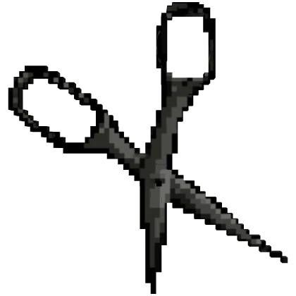

<p align="center">
  <picture>
    <source media="(prefers-color-scheme: dark)" srcset="docs/scissors-dark.png">
    
  </picture>
</p>

<h1 align="center">FirstCut</h1>

<p align="center">
  <b>Le dérush automatique pour Premiere Pro.</b><br>
  Silences, caméras, zooms et B-rolls, en un clic.
</p>

<p align="center">
  Créé par <a href="https://github.com/quentiinct">@quentiinct</a><br>
  <a href="https://github.com/quentiinct/firstcut/actions/workflows/build.yml"></a>
</p>

## Installer (Windows)

1. Télécharge `FirstCut-Setup-<version>.exe` dans les [Releases](https://github.com/quentiinct/firstcut/releases/latest).
2. Double-clique dessus, puis **Installer**.
3. Redémarre Premiere Pro, puis **Fenêtre › Extensions › FirstCut**.

> **« Windows a protégé votre ordinateur » ?** Clique **Informations complémentaires**, puis
> **Exécuter quand même**. Le message vient du fait que l'installateur n'est pas signé.

- Ni droits administrateur, ni compte.
- Active `PlayerDebugMode` (Premiere accepte alors les panneaux non signés). Ce réglage
  reste en place à la désinstallation, car d'autres panneaux peuvent en avoir besoin.
- Une présentation guidée s'ouvre au premier lancement.
- Désinstaller : **Paramètres › Applications › FirstCut**.

## Les outils

| Outil | Ce qu'il fait |
| --- | --- |
| **Montage express** | Silences, POV et Zoom enchaînés en un clic. |
| **Silences** | Coupe les blancs, en gardant le lien image / son. |
| **POV** | Affiche la caméra de la personne qui parle (un micro par personne). |
| **Zoom** | Ajoute des zooms au hasard, vers le centre ou vers un point choisi. |
| **B-roll** | Illustre ce qui est dit, depuis une banque en ligne ou ton dossier. |

Chaque outil travaille sur toute la timeline, entre l'entrée et la sortie, ou sur les
clips sélectionnés. Avant chaque modification, ta séquence est dupliquée.

## Configuration requise

- Windows 10 ou 11, Premiere Pro 2021 (15.0) ou plus récent.
- Pour B-roll, en option : une clé Pexels (vidéos en ligne), une clé Claude (choix par IA)
  et ffmpeg (pour ton dossier de vidéos). La transcription se télécharge au premier usage.
- Tes clés API restent sur ton PC, chiffrées avec ta session Windows.
- Mac : pas d'installateur pour l'instant.

## Développer

```powershell
.\install.ps1 -ActiverModeDebug     # copie extension\ dans Premiere
node --test tests/                   # détection, plans, transcription
cscript //nologo tests\jsx\run.wsf   # logique Premiere sur une timeline simulée
.\installer\build.ps1               # fabrique dist\FirstCut-Setup-<version>.exe
```

Aperçu sans Premiere : ouvre `extension/index.html?demo` dans Chrome.
Réglages, limites et organisation du code : [docs/GUIDE.md](docs/GUIDE.md).

## Confidentialité

This program will not transfer any information to other networked systems unless
specifically requested by the user or the person installing or operating it.

FirstCut n'envoie rien tant que tu n'utilises pas une fonction en ligne. Dans ce cas :

| Quand | Ce qui part | Vers |
| --- | --- | --- |
| B-roll, banque en ligne | les mots-clés cherchés (et ta clé Pexels si tu en as mis une) ; les images retenues sont téléchargées | [Pexels](https://www.pexels.com/privacy-policy/), [Openverse](https://openverse.org/privacy) |
| B-roll, choix par IA Claude | le texte transcrit ; quelques images de tes vidéos si tu fais décrire ton dossier ; ta clé Claude | [Anthropic](https://www.anthropic.com/legal/privacy) |
| Transcription, premier usage | rien de ton projet : téléchargement de whisper.cpp et de son modèle (l'audio reste sur ton PC) | [GitHub](https://docs.github.com/site-policy/privacy-policies/github-general-privacy-statement), [Hugging Face](https://huggingface.co/privacy) |

## Code signing policy

Free code signing provided by [SignPath.io](https://about.signpath.io), certificate by [SignPath Foundation](https://signpath.org)

- Committers and reviewers: [@quentiinct](https://github.com/quentiinct)
- Approvers: [@quentiinct](https://github.com/quentiinct)

L'installateur est compilé par [GitHub Actions](.github/workflows/build.yml) à partir de ce dépôt.
Chaque version est validée à la main avant d'être signée.

## Licence

[MIT](LICENSE) : libre d'utiliser, modifier et redistribuer FirstCut, en gardant la mention de copyright.
